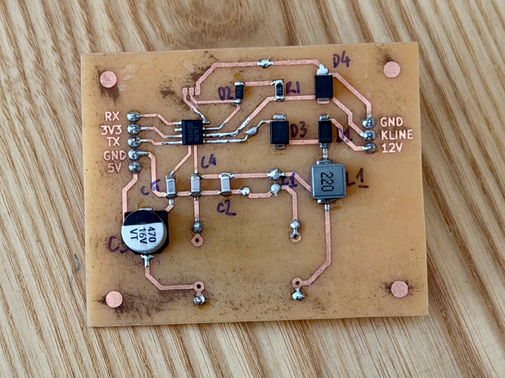
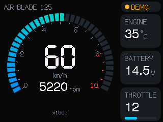

# AB125 K-Line: đọc dữ liệu ECU Honda Air Blade 125 (2023) qua giắc DLC

> **English summary.** DIY reader for the Honda K-Line diagnostic port on a Honda Air Blade 125 (2023, PGM-FI) scooter. An ESP32-C3 talks to the ECU through an L9637D transceiver, decodes RPM, speed, coolant/intake temperature, throttle and battery voltage from Honda table `0x17`, and shows them on a phone (WiFi web page) and on a 2.8" "Cheap Yellow Display" dashboard (ESP-NOW). Firmware (PlatformIO/Arduino), KiCad schematic + PCB, and the decoded protocol are all here. Docs are in Vietnamese.

<p align="center">
  
  
</p>

## Tính năng
- Đọc **vòng tua, tốc độ, nhiệt độ máy, nhiệt độ khí nạp, độ mở bướm ga, điện áp ắc quy** khoảng 7 lần mỗi giây.
- **Trang web trên điện thoại:** kết nối WiFi `AB125`, mở `http://192.168.4.1`. Không cần cài app.
- **Đọc mã lỗi PGM-FI** (lỗi hiện tại và lỗi đã lưu) kèm mô tả tiếng Việt. Đã kiểm chứng bằng một lỗi thật tạo ra có chủ đích (8-1). Có nút **xóa lỗi** (đã thử thành công trên xe), chỉ hoạt động khi máy không nổ. Xem [protocol.md](docs/protocol.md#mã-lỗi-dtc).
- **Dashboard màn CYD 2.8"** nhận dữ liệu không dây qua ESP-NOW: đồng hồ RPM, tốc độ, cảnh báo nhiệt độ và điện áp.
- **Ghi log** dữ liệu thô ra file để phân tích.
- Mạch giao tiếp **L9637D** tự làm được trên PCB 1 mặt. File KiCad có đủ schematic và PCB.

## Sơ đồ hệ thống
```
 Giắc DLC trên xe            Mạch L9637D                ESP32-C3 SuperMini
 ┌──────────┐  +12V  ┌──────────────────────┐  5V/3V3  ┌──────────────────┐   WiFi AP "AB125"   ┌─────────┐
 │ +12V     ├───────►│ bảo vệ + lọc + MP1584 ├────────►│                  ├────────────────────►│ Điện    │
 │ K-Line   ├◄──────►│ L9637D (K ↔ TX/RX)   ├◄───────►│ firmware         │                     │ thoại   │
 │ GND      ├────────┤                      │ TX / RX │ kline-reader     │   ESP-NOW (kênh 1)  └─────────┘
 └──────────┘        └──────────────────────┘         └──────────────────┴────────────────────► Màn CYD 2.8"
```

## Cấu trúc repo
```
firmware/
  kline-reader/      firmware đọc K-Line (ESP32-C3 SuperMini, hoặc ESP32 + mạch 2N2222 v1)
  dashboard-cyd/     firmware dashboard cho màn CYD 2.8" (ESP32-2432S028R)
  common/            dash_packet.h: định dạng gói ESP-NOW dùng chung
  flash.sh           build + nạp, chọn đúng board theo địa chỉ MAC
hardware/
  kline-l9637d/      project KiCad: schematic, PCB, BOM, PDF
docs/
  protocol.md        giao thức Honda K-Line và cấu trúc bảng 0x17
  hardware.md        lắp ráp mạch L9637D, nối dây, kiểm tra trước khi cấp điện
  v1-discrete-circuit.md   mạch v1 dùng transistor 2N2222 (không cần IC)
  images/            ảnh mạch, dashboard, ảnh render PCB
  sample-logs/       log thật ghi trên xe (tắt máy, không tải, vặn ga, quay bánh)
```

## Bắt đầu nhanh
Cần cài [PlatformIO](https://platformio.org/) (bản dòng lệnh hoặc extension VS Code).

1. **Làm mạch:** theo [docs/hardware.md](docs/hardware.md). Nếu chưa có IC L9637D, có thể làm mạch v1 bằng transistor: [docs/v1-discrete-circuit.md](docs/v1-discrete-circuit.md).
2. **Khai báo MAC các board:** chép `firmware/boards.local.example` thành `firmware/boards.local` rồi điền MAC. Chạy `./flash.sh` sẽ in ra MAC của mọi board đang cắm.
3. **Nạp firmware:**
   ```bash
   cd firmware
   ./flash.sh -e c3_supermini     # bộ đọc K-Line (ESP32-C3 + L9637D)
   ./flash.sh -e cyd              # dashboard CYD (không bắt buộc)
   ```
4. **Thử trên bàn:** cấp 12V vào mạch. Log phải báo `INIT FAIL, code=0`: mạch đã chạy, chỉ thiếu ECU để trả lời.
5. **Cắm vào xe và bật khóa:** log báo `INIT OK`, rồi in các dòng `rpm=… km/h=…`.

Chi tiết từng phần:
- [firmware/kline-reader/README.md](firmware/kline-reader/README.md)
- [firmware/dashboard-cyd/README.md](firmware/dashboard-cyd/README.md)
- [hardware/kline-l9637d/README.md](hardware/kline-l9637d/README.md)

## Giao thức
Honda dùng K-Line 10400 baud với tập lệnh riêng, **không phải OBD2**, nên ELM327 không đọc được. Phần đánh thức ECU, cách đọc bảng và ý nghĩa từng byte của bảng `0x17` (đã kiểm chứng trên xe) xem ở [docs/protocol.md](docs/protocol.md).

## ⚠️ Lưu ý an toàn
- Đây là dự án cá nhân, đã thử trên **một** xe Air Blade 125 đời 2023. Các đời xe khác có thể khác cấu trúc bảng dữ liệu.
- Firmware chỉ gửi lệnh **đọc**, không ghi gì vào ECU.
- Lắp **cầu chì 1A** trên dây 12V. Không chập các chân của giắc DLC.
- **Không xem màn hình khi đang chạy xe.**
- Bạn tự chịu trách nhiệm khi can thiệp vào hệ thống điện của xe.
