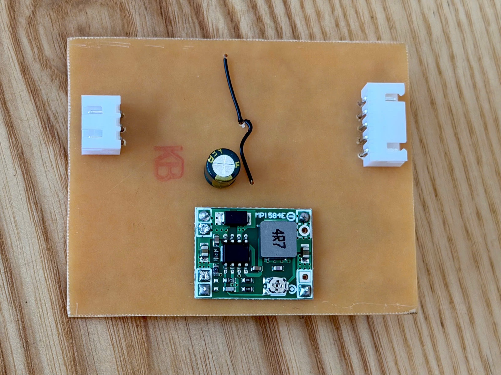
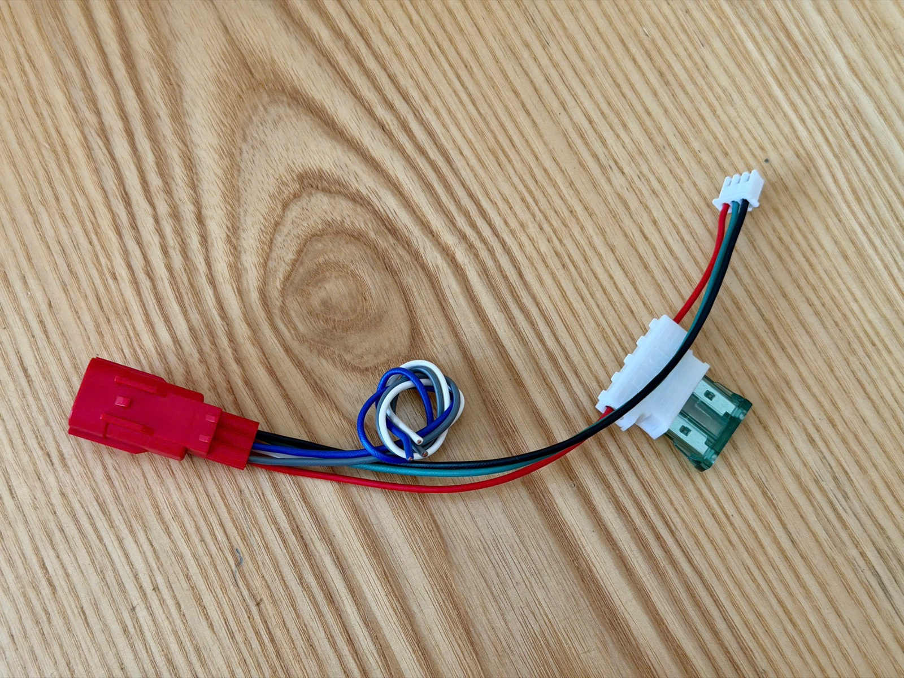
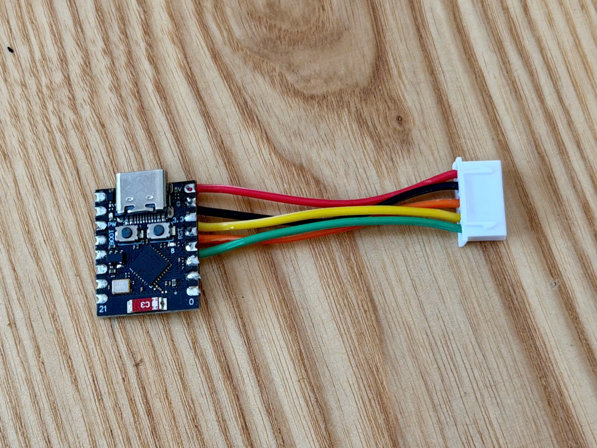

# Mạch giao tiếp K-Line dùng L9637D

Project KiCad: [hardware/kline-l9637d](../hardware/kline-l9637d). Có sẵn bản [PDF schematic](../hardware/kline-l9637d/kline_l9637d_schematic.pdf) và [BOM](../hardware/kline-l9637d/bom.csv).

  
  

## Nguyên lý
- **Nguồn vào:** đi qua diode SS34 (D1, chống cắm ngược cực), TVS SMBJ24A (D3), rồi bộ lọc 22µH + 100µF + 100nF, tạo ra đường **VS**.
- **Nguồn 5V:** module **MP1584** hạ VS xuống 5V để cấp cho ESP32. Phải **chỉnh module ra đúng 5.0V trước khi hàn vào mạch**.
- **L9637D:** chân VS nối đường 12V đã lọc. Chân **VCC lấy 3.3V từ ESP32**, nên TX và RX nối thẳng vào GPIO, không cần mạch chuyển mức.
- **Đường K-Line:** kéo lên 12V qua 1N4148W và 1kΩ, chống xung bằng TVS (D4).
- **JP1:** cầu hàn nối **LI lên VS**. Mạch không dùng đường L-Line.

## Những gì đã đối chiếu với datasheet (ST L9637, Doc ID 1765)
- **Sơ đồ chân:** 1 RX, 2 LO, 3 VCC, 4 TX, 5 GND, 6 K, 7 VS, 8 LI.
- **VCC:** hoạt động từ 3 đến 7V. ST chỉ đo kiểm ở 5V, cả dải còn lại được đảm bảo bằng thiết kế. Chạy 3.3V đã thử thành công trên xe.
- **TX:** nhận mức cao từ 2.5V. TX và RX đều có điện trở kéo lên VCC bên trong, nên khi ESP32 đang khởi động, K-Line vẫn nằm yên ở mức nghỉ.
- **Không đảo mức:** TX ở mức thấp thì K-Line xuống thấp. Firmware dùng `K_TX_INVERTED=0`.
- **Điện trở kéo lên K-Line bên ngoài:** phải ≤ 5kΩ. Mạch dùng 1kΩ.

## Giắc nối
**J1, nối vào giắc DLC của xe** (JST-XH 3 chân):

| Chân | Tín hiệu |
|---|---|
| 1 | +12V (chân DLC có điện **sau khóa**). Lắp **cầu chì 1A** trên dây này |
| 2 | K-Line |
| 3 | GND |

**J2, nối sang ESP32-C3 SuperMini** (JST-XH 5 chân):

| Chân | Tín hiệu | C3 SuperMini |
|---|---|---|
| 1 | +5V (từ MP1584) | 5V |
| 2 | GND | GND |
| 3 | TX (sang chân 4 của L9637D) | **GPIO4** |
| 4 | +3V3 (cấp VCC cho L9637D) | 3.3 |
| 5 | RX (từ chân 1 của L9637D) | **GPIO3** |

⚠️ **Không cắm USB vào C3 khi J2 đang có 5V.** Nhiều bản SuperMini nối chân 5V thẳng vào nguồn USB. Khi nạp code, rút J2 ra, hoặc hàn thêm một diode Schottky nối tiếp trên dây 5V.

## Linh kiện
Xem [bom.csv](../hardware/kline-l9637d/bom.csv). Một số ghi chú:
- **D4:** dùng SMBJ18A (mã in trên thân **LT**). SMBJ28A (mã **MG**) dùng tạm được: tín hiệu không bị ảnh hưởng, chỉ có điện áp kẹp khi gặp xung cao hơn. **Đừng dùng SMBJ28A cho D3.**
- **D3:** SMBJ24A (mã **LZ**).
- **C1, C3:** tụ nhôm có phân cực. C1 là loại xuyên lỗ, pad vuông là cực +. C3 là loại dán, vạch đen trên thân là cực −.
- **Cầu chì:** dùng cầu chì ô tô 1A lắp trên dây 12V, không đặt trên mạch.

## Làm mạch in tự chế (1 mặt)
- Lớp đồng ở **mặt dưới (B.Cu)**. Linh kiện dán đặt ở mặt đồng, linh kiện xuyên lỗ cắm từ mặt trên.
- **Thông số đi dây:**
  - Khoảng cách tối thiểu 0.4–0.5mm.
  - Đường tín hiệu rộng 0.6–0.8mm, đường nguồn 1.0–1.5mm.
  - Không cho đường dây chạy giữa hai chân SO-8.
- **In để là ủi:** chọn **File → Plot**, lớp B.Cu và Edge.Cuts, tỉ lệ 1:1, **không lật ngược** (mirror). Bật drill marks để dễ đục tâm khi khoan.
- **Nhận biết chân 1 của L9637D khi không có chấm tròn:** đặt IC sao cho chữ đọc xuôi. Cạnh dài bị vát nhiều hơn là hàng chân 1–4, và chân 1 nằm ở góc dưới bên trái.

## Đo trước khi cấp điện (chưa nối ESP32, chưa cắm vào xe)
1. **Soi cầu thiếc** ở 8 chân của U1. Kiểm tra chiều D1–D4, C1, C3. Kiểm tra JP1 đã được nối.
2. **Đo chập (thang Ω hoặc thang kêu):**
   - GND với +12V, VS, +5V, K-Line, +3V3: không được chập. Riêng VS và +5V có thể đo được trở thấp lúc đầu rồi tăng dần, đó là tụ đang nạp.
   - Từng cặp chân cạnh nhau của U1: không được chập. **Riêng chân 7–8 kêu là đúng**, vì JP1 nối hai chân này.
3. **Đo diode (thang diode):**
   - D1 (SS34): 0.2–0.4V.
   - D3 và D4 (que đỏ ở GND, que đen ở đầu catốt): ~0.6–0.7V.
4. **Cấp 12V qua nguồn có giới hạn dòng (100–200mA):**
   - VS ≈ 11.6–11.8V.
   - +5V = 5.0V.
   - K-Line ≈ 11V.
   - Dòng tiêu thụ khoảng 10–30mA.
   - Sau 1 phút, không linh kiện nào được ấm.
5. **Nối ESP32 đã nạp firmware:** log phải báo `INIT FAIL, code=0`. Nghĩa là mạch đã gửi và nhận được tín hiệu, chỉ thiếu ECU để trả lời. Sau đó mới cắm vào xe.
