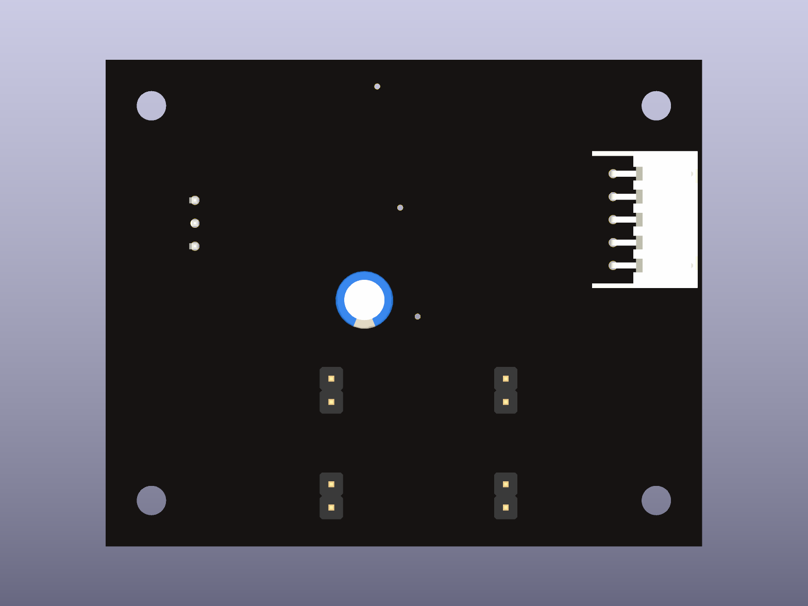
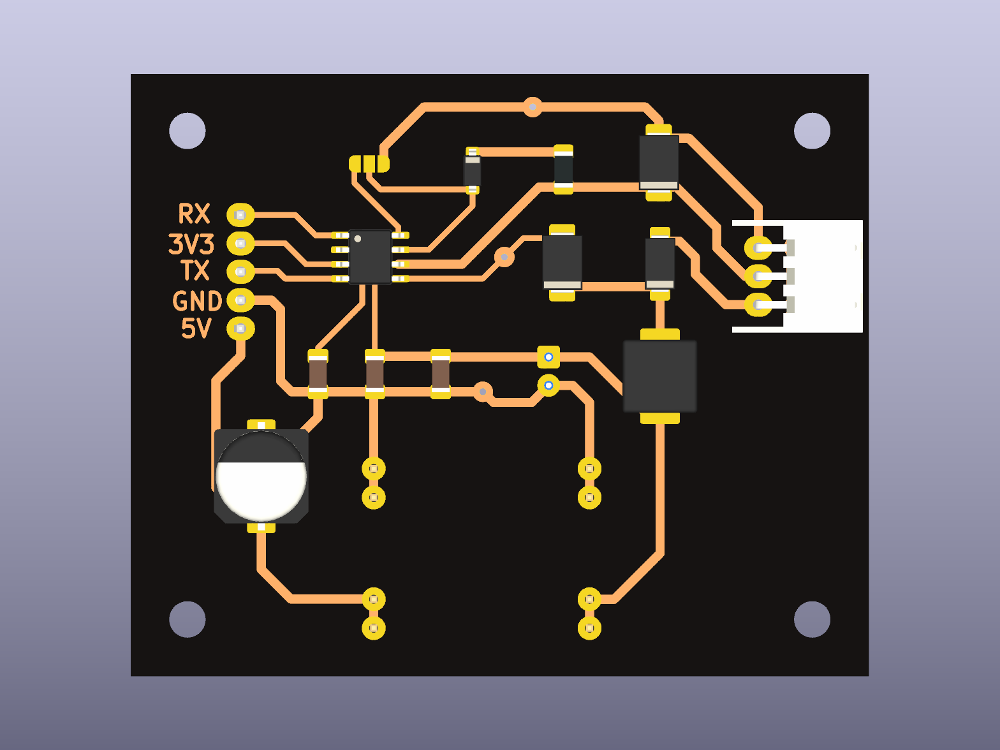

# kline-l9637d: mạch giao tiếp K-Line (KiCad)

Mở `kline_l9637d.kicad_pro` bằng **KiCad 9 hoặc 10**. Symbol của L9637D nằm sẵn trong project, ở file `kline.kicad_sym` (khai báo qua `sym-lib-table`). Không cần cài thêm thư viện.

| File | Nội dung |
|---|---|
| `kline_l9637d.kicad_sch` | Schematic |
| `kline_l9637d.kicad_pcb` | PCB 1 mặt (lớp B.Cu) để tự làm mạch |
| `kline_l9637d_schematic.pdf` | Bản PDF của schematic |
| `bom.csv` | Danh sách linh kiện |

**Kết quả kiểm tra:**
- ERC: 0 lỗi.
- DRC: 0 lỗi, 0 pad chưa nối. Còn lại vài cảnh báo: footprint đã được chỉnh pad để dễ làm mạch tự chế, và silkscreen chồng lên pad.

  
  

Hướng dẫn lắp ráp và kiểm tra: [docs/hardware.md](../../docs/hardware.md).
